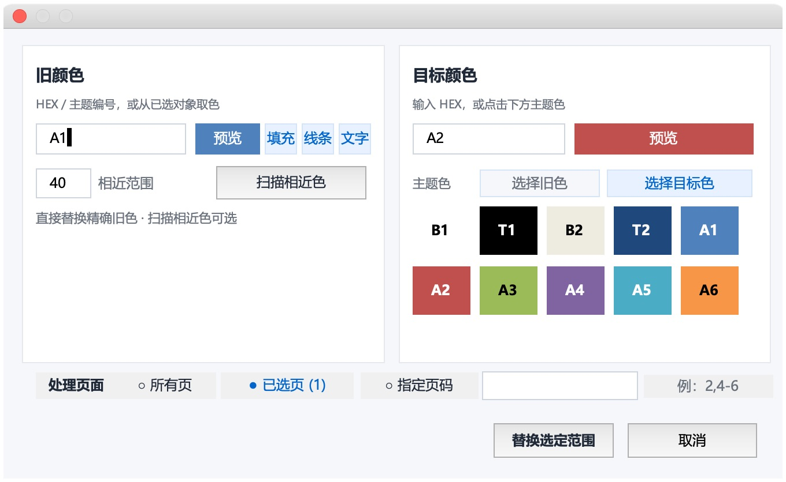

# Mac PowerPoint 批量改色

**Mac PowerPoint Batch Color Replacer**

专为 Mac 桌面版 PowerPoint 制作的中文批量改色加载项。在当前打开的演示文稿中，把固定 RGB 颜色或主题色替换为另一种颜色或主题色。

**当前版本：0.1.0-beta.2 · 测试版**  
**开源许可证：MIT**  
**发布渠道：GitHub 预发布 · 请先使用自制示例试用。**

## 下载测试版

- **[下载 Mac 安装包](https://github.com/WenkoLee/mac-powerpoint-batch-color/releases/download/v0.1.0-beta.2/MacPowerPointBatchColor_0_1_0_beta_2_Mac.zip)**：普通用户推荐，包含插件、中文说明和自制示例。
- [测试版发布页](https://github.com/WenkoLee/mac-powerpoint-batch-color/releases/tag/v0.1.0-beta.2)：独立 PPAM、完整源码包与 SHA256 校验文件。
- [安装说明](docs/INSTALL.md) · [用户指南](docs/USER_GUIDE.md) · [验收记录](docs/acceptance/ACCEPTANCE.md)

## 为什么开发这个插件

这个项目来自一个很具体的工作需求：一份演示文稿中，形状、文字、表格和图表使用了相同或接近的蓝色，需要统一换成新的品牌颜色，或者绑定到主题色。

在 Mac 版 PowerPoint 中，逐页寻找对象、分别修改填充、线条和文字，容易遗漏，且极为琐碎。但我没找到同时满足“Mac 可用、专注批量改色、中文界面、直接修改当前文件”这些要求的轻量工具。一些现有插件能解决其中部分问题，但也附带很多我不需要的功能。

因此，我开发了这个插件，集中处理颜色扫描、选择页面、预览目标色和批量替换。初衷是轻量化的实现批量换色的功能

## 可以做什么

- 在同一面板输入旧色和目标色，并查看两者的颜色预览。
- 输入六位 HEX 色号或选择主题旧色，也可以从页面上的已选对象读取填充、线条或文字颜色。
- 通过“选择旧色 / 选择目标色”切换色板用途；支持主题色互换。
- 打开面板后继续选择其他对象或页面，面板同步相关信息。
- 默认处理当前页；选择缩略图中的多页时自动同步，也可处理所有页或指定页码。
- 无需扫描即可精确替换；需要扩大范围时再扫描相近颜色、核对并勾选候选。
- 将 RGB 或主题旧色换成新的 HEX 或主题色；主题色互换保留原有明暗变化。
- 遍历可访问的形状、文字、组合、表格填充与边框，以及图表系列和数据点颜色。
- 在当前打开的文件中直接操作，完成后继续编辑，再由你决定是否保存。
- 使用插件的“撤销上次改色”回退最近一次改色。
- 可以粘贴色号，粘贴时读取纯文字，不带入原字体和富文本格式。

## 界面预览



同屏查看旧色、目标色和扫描候选；可选择所有页、已选页或指定页码。更多说明见 [用户指南](docs/USER_GUIDE.md)。

## 普通用户从这里开始

1. 阅读 [安装与卸载](docs/INSTALL.md)。测试版安装文件放在 [release](release/) 目录。
2. 先使用 [自制示例](examples/) 熟悉操作，或复制一份自己的演示文稿进行试用。
3. 在 PowerPoint 顶部选择 **Mac 批量改色·测试版 → 打开选色面板**。
4. 选择旧色与页面范围；仅替换精确旧色时可直接继续，**扫描相近色**为可选步骤。
5. 输入目标色或点击主题色，再点击 **替换选定范围**。
6. 若需要回退，使用顶部 **撤销上次改色**；确认结果后正常保存文件。

完整说明：[用户指南](docs/USER_GUIDE.md) · [常见问题](docs/FAQ.md) · [兼容性与限制](docs/COMPATIBILITY.md)。

## 适用范围

这是 **Mac 桌面版 PowerPoint 的 VBA 加载项（`.ppam`）**。不适用于 PowerPoint 网页版、iPhone/iPad 版、Keynote 或 WPS。Windows 尚未作为本项目支持平台进行验收。

旧色可使用 **HEX 或主题色编号**：HEX 按当前 RGB 匹配；主题编号按色位匹配，可包含该色位的明暗变体。Mac 图表的主题读取存在限制，详见兼容性说明。图片像素、渐变各色标、SmartArt 内部元素及部分特殊图表属性不属于完整支持范围。

选择“所有页”时，也会遍历母版和版式中的可访问形状；选择部分页面时不遍历母版与版式。

## 开发与构建

需要 Python **3.10 或更高版本**。构建依赖已作为授权快照放入 `vendor/`，不需要连接网络安装依赖。

```sh
python3 scripts/build.py
python3 -m unittest discover -s tests -p 'test_*.py' -v
python3 scripts/audit.py
```

产物位于 `release/`。源码、中文编码处理、界面控件、空白宿主模板和构建步骤均在项目内部，构建不依赖原开发目录。

详细说明见 [开发与构建](docs/DEVELOPMENT.md)。实际加载项行为需要在 Mac PowerPoint 中验收，静态测试不能替代应用内测试。

## 测试版状态

本次自制测试稿的 **99 项应用内断言全部通过**；最终安装包已验证主题旧色选择、无需扫描直接替换、当前页默认范围、对象/多页同步、主题色回退、无效输入隔离和不保存关闭后立即重开。格式化剪贴板专项测试记录保留在首版验收中。详见 [验收记录](docs/acceptance/ACCEPTANCE.md)。实体 Command 快捷键、受组织策略管理的宏设置以及其他 Mac/Office 组合仍待补测。

## 反馈与参与

反馈时请描述 PowerPoint 和 macOS 版本、页面范围、旧色与目标色、涉及的对象类型、实际结果和预期结果。可以提供去除业务信息后的最小示例。

提交代码前阅读 [贡献说明](CONTRIBUTING.md)。项目采用 [MIT 许可证](LICENSE)，第三方资源与依赖的授权见 [第三方声明](THIRD_PARTY_NOTICES.md)。

本项目为独立项目，与 Microsoft 无隶属或官方认证关系。PowerPoint 名称用于说明适用的软件。
