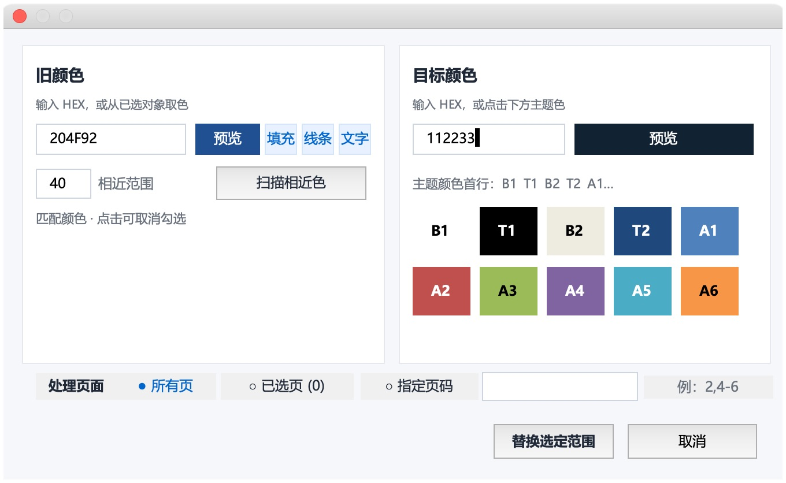
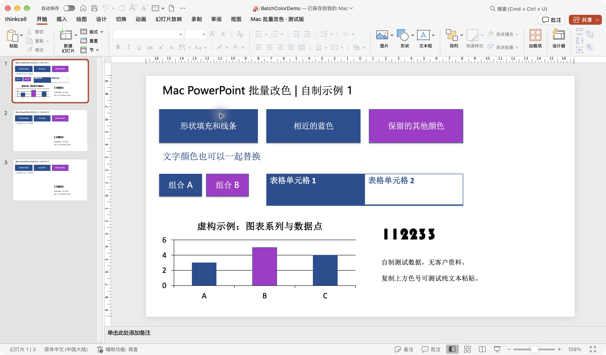
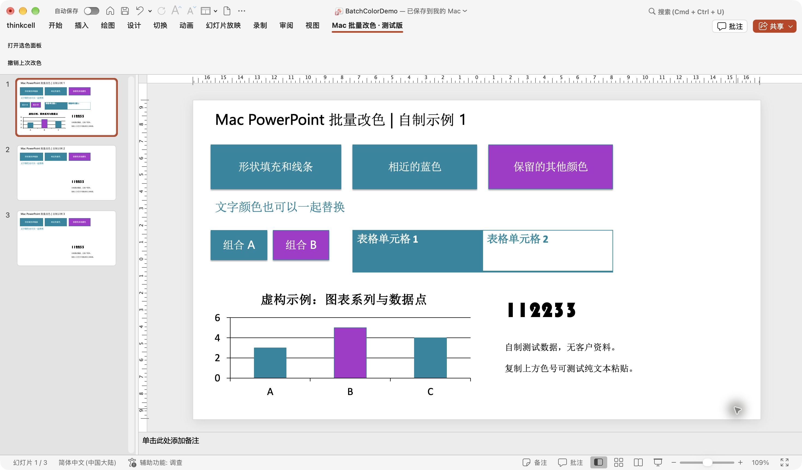

# 用户指南

适用于 **Mac PowerPoint 批量改色 0.1.0-beta.1 测试版**。

## 界面与示例

截图来自本机测试版，使用项目自制示例。示例文件位于 `examples/BatchColorDemo.pptx`。

面板左侧选择旧颜色并扫描候选色，右侧选择目标 HEX 或主题色；底部选择处理页面。

## 1. 打开要处理的文件

在 PowerPoint 中打开文件，点击 **Mac 批量改色·测试版 → 打开选色面板**。面板可以拖到旁边；它只处理打开面板时对应的演示文稿。

操作直接作用于当前文件。改完后可以继续编辑，再由你决定是否保存。

## 2. 选择页面范围

| 选项 | 用法 |
| --- | --- |
| 所有页 | 遍历整份文件，并包含母版与版式中的可访问形状 |
| 已选页 | 在左侧缩略图中选择页面，面板显示已选数量；可先打开面板再选页 |
| 指定页码 | 输入 `2,4-6`，表示第 2、4、5、6 页；不遍历母版与版式 |

Mac 的页面多选通常使用 Command 加点击，连续选择通常使用 Shift 加点击。

更换页面范围或旧色后，需要重新扫描。

## 3. 选择旧颜色

可以直接输入 `204F92` 或 `#204F92`。也可以选择页面上的一个对象，再点击面板中的 **填充**、**线条** 或 **文字** 读取对应颜色。

面板打开后可以继续选择其他对象，取色类型保持为最近选择的“填充/线条/文字”。文本对象有多种文字颜色时，整对象取色通常读取首个文字片段；需要精确取某段文字时，应先选中那段文字。

复制色号时，尽量复制文字本身。直接复制整个形状或图片，剪贴板可能没有可用的纯文本，面板会保留原输入并提示。

## 4. 扫描完全相同或相近的颜色

- 相近范围 **0**：仅匹配完全相同的固定 RGB 色号。
- 相近范围 **40**：扫描较接近的颜色，具体以候选列表和预览为准。
- 可输入范围为 **0—442**；数值越大，候选颜色越多。

这里使用 RGB 三个通道的距离，不代表严格的人眼感知色差。建议从较小范围开始，逐项核对候选色。

点击 **扫描相近色** 后，列表显示具体色号和扫描使用次数。默认勾选，点击某一项可取消勾选。

## 5. 选择目标颜色

输入六位 HEX 使用固定 RGB；点击主题色将对象绑定到对应主题色位。

| 面板编号 | PowerPoint“主题颜色”首行位置 |
| --- | --- |
| B1、T1、B2、T2 | 从左数第 1、2、3、4 格 |
| A1—A6 | 从左数第 5—10 格 |

**要选首行第 4 格，请点击 T2。** 实际颜色由当前演示文稿主题决定，不是固定的蓝色。

## 6. 替换与撤销

点击 **替换选定范围**，确认后执行替换。面板关闭并报告实际改色处数。

需要回退时，点击顶部的 **撤销上次改色**。该功能记录最近一次插件改色，包括可访问的图表颜色。执行下一次替换会覆盖上一份撤销记录。

请在删除对象、重排页面或改变图表结构之前使用插件撤销。记录按对象路径解析，结构发生变化后可能无法找到原对象。若提示只恢复部分颜色，请检查结果，再决定是否保存。

PowerPoint 自带的 Command+Z 不保证完整回退 VBA 改动，尤其是图表；改色回退应使用插件按钮。

## 7. 色号文本框

色号框提供全选、复制、剪切、粘贴以及文本撤销处理。Command+A/C/X/V/Z 是面向 Mac 用户实现的快捷键，实体 Command 键尚未在本轮单独确认。已实测可用的兼容操作为 **Control+A/C/X/V**，分别用于全选、复制、剪切、粘贴；Control+Z/Y 的文本撤销/重做实现仍待本轮补测。具体边界见 [验收记录](acceptance/ACCEPTANCE.md)。

粘贴只接收纯文字，不带入“华文琥珀”等原字体格式。开头的 `#`、空白和常见不可见字符会被清理；全角数字与全角 A—F 会归一为普通字符。无效可见字符会被拒绝，保留原色号。

`112233` 是合法的六位色号。输入未完成时显示格式提示并保留最近一次有效预览；点击替换时会再次校验。

## 处理边界

固定 RGB 是旧色扫描对象。一般形状和文字中已绑定主题色的对象会跳过。Mac 图表接口有时会把主题色报告为固定 RGB，不能据此保证图表主题色不被扫描；请检查候选结果。图片像素、渐变各色标、SmartArt 内部颜色、图表标题/坐标轴等特殊元素不承诺自动处理。

使用次数可能包含图表继承的颜色，实际可写入次数以替换结果为准。

## 实际改色示例

**修改前：**

**将接近的蓝色统一替换为 0086A1 后：**

这是自制演示文稿的真实 PowerPoint 截图，紫色不属于所选旧色，保持原样。截图操作后选择“不保存”，示例文件仍保留原始蓝色，便于重复试用。
