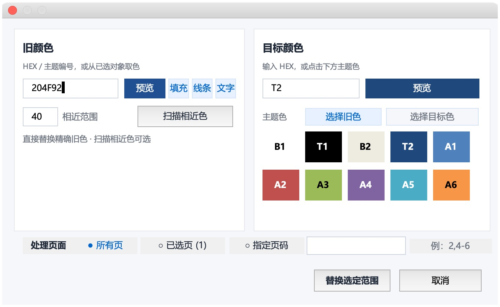

# 用户指南

适用于 **一键改色 0.1.2**。

截图来自最终安装包的实际 PowerPoint 面板，不含客户资料。

## 快速开始

1. 打开要处理的文件，点击 **一键改色 → 打开选色面板**。
2. 选择旧颜色和目标颜色，确认两侧预览。
3. 确认底部页面范围。默认“所有页”；仅处理当前页或部分页面时，切换到“已选页”或“指定页码”。
4. 点击 **替换选定范围**。仅精确替换时无需扫描。
5. 检查结果，需要回退时使用顶部 **撤销上次改色**；满意后正常保存。

插件直接修改当前打开的文件，可以继续编辑，不自动保存或重新打开。

## 1. 页面范围

| 选项 | 用法 |
| --- | --- |
| 已选页 | 选中页面上的对象或文字时，自动采用该对象所在的当前页；无需再点缩略图 |
| 已选页中的多页 | 在左侧缩略图多选，面板同步数量；打开面板后仍可重新选择 |
| 所有页（默认） | 遍历整份文件，并包含母版与版式中的可访问形状 |
| 指定页码 | 输入 `2,4-6`，表示第 2、4、5、6 页；不遍历母版与版式 |

页面多选通常使用 Command 加点击，连续选择可用 Shift 加点击或 Shift 加方向键。选择对象会重新采用当前页，不沿用之前的多页选择。

打开面板后可继续选择对象和页面，面板保持打开并同步。更换旧色或页面范围会清空原扫描候选，可以直接精确替换；如仍需相近色，再扫描一次。

## 2. 旧颜色与目标颜色

两侧都接受六位 HEX，例如 `204F92` 或 `#204F92`，以及主题编号 `B1/T1/B2/T2/A1-A6`。

右侧色板可复用：先点 **选择旧色** 或 **选择目标色**，再点色块。也可以先点击对应输入框，再用色板。两侧预览分别显示当前输入。

| 编号 | PowerPoint“主题颜色”首行位置 |
| --- | --- |
| B1、T1、B2、T2 | 从左数第 1、2、3、4 格 |
| A1—A6 | 从左数第 5—10 格 |

**首行第 4 格为 T2。** 预览由当前演示文稿的主题决定；不同主题的颜色可能不同。

### 两种旧色匹配方式

- **HEX**：按对象当前 RGB 匹配，包括固定 RGB 和显示为同一 RGB 的主题色对象。
- **主题编号**：按主题色位匹配。例如旧色 A1、目标 A2，会把使用 A1 的对象迁移到 A2，包含 A1 的明暗变体。普通形状、文字和表格中，仅 RGB 相同但没有绑定 A1 的对象不会因此被修改。

主题→主题会保留原有明暗变化；目标为固定 HEX 时清除明暗变化，得到输入的固定 RGB。一个文件含多个设计主题时，主题编号依照各页所属主题处理；预览显示当前页主题。

Mac 图表接口不能可靠读回主题色位；图表按主题旧色匹配时会退回该页主题色位的基础 RGB，因此可能同时匹配图表中 RGB 相同的固定颜色。详细范围见 [兼容性](COMPATIBILITY.md)。

### 从页面取色，包括组合内对象

选择页面上的一个对象，点击面板的 **填充 / 线条 / 文字**，读取该类型颜色。打开面板后选另一个对象，会按最近使用的类型更新旧色。

组合不需要解组：继续点击或在选择窗格中选中组合内部的具体对象，再读取颜色。嵌套组合的具体子对象同样支持。选中整个组合时，如果子对象颜色不同，没有唯一旧色；请继续选择具体子对象，插件不会用组合容器的颜色代替。

对象取色得到当前 RGB。若希望按主题色位替换其全部明暗变体，请再用“选择旧色”选对应主题编号。整段文字含多种颜色时，整对象取色通常读取首个片段；也可先选中具体文字。

## 3. 扫描相近色是可选步骤

不扫描时，直接点击替换，只按旧色 HEX 或主题编号精确匹配；“相近范围”不会影响直接替换。

需要把一组接近颜色统一调整时，点击 **扫描相近色**：

- 范围 **0**：扫描与旧色预览 RGB 完全相同的颜色。
- 范围 **40**：扫描较接近的 RGB，逐项核对候选。
- 可输入 **0—442**；数值越大，候选越多。

使用 RGB 三通道距离，并非严格的人眼感知色差。扫描包含固定 RGB 和主题对象当前颜色。即使旧色填主题编号，扫描后的候选也是具体 RGB；替换勾选候选时按这些 RGB 匹配，可能同时包含其他主题色位或固定颜色。要按主题色位迁移，请直接替换。

候选默认勾选，点击某项可取消勾选。更换旧色或范围后旧列表失效并清空，不会沿用旧候选。

## 4. 替换与撤销

点击 **替换选定范围**，确认后执行。成功后面板关闭并报告实际改色处数；没有匹配时保持面板打开，文件不变。

使用顶部 **撤销上次改色** 回退最近一次插件操作。普通对象会恢复原主题关联及明暗变化；文字按字符位置记录，避免改色后相邻片段合并而漏回退。可访问的图表颜色也纳入回退，但部分图表格式存在限制。

下一次替换会覆盖上一份撤销记录。关闭文件、退出 PowerPoint 或卸载插件后，这份内存记录不可用。删除对象、重新组合或改变图表结构前，应先检查并按需回退。PowerPoint 自带 Command+Z 不保证完整回退 VBA 修改，尤其是图表。

## 5. 输入和粘贴

色号框实现全选、复制、剪切、粘贴与文本撤销处理。Command+A/C/X/V/Z 为面向 Mac 的实现；实体 Command 键仍待单独确认。已实测的兼容操作为 **Control+A/C/X/V**。部分文字选择、文本撤销/重做的验证边界见 [验收记录](acceptance/ACCEPTANCE.md)。

粘贴读取纯文字，不带入原字体。开头 `#`、空白和常见不可见字符会清理；全角数字与 A—F 归一为普通字符。无效可见字符会被拒绝，保留原色号。复制整个形状或图片时，剪贴板可能没有可用纯文字，面板会提示。

`112233` 是合法色号。输入未完成时保留最近有效预览；点击替换会再次校验，无效输入不会执行改色。

格式化剪贴板专项测试及截图保留于 [首版验收](https://github.com/WenkoLee/mac-powerpoint-batch-color/blob/v0.1.0-beta.1/docs/acceptance/ACCEPTANCE.md)。

## 处理边界

支持可访问的原生形状、文字、组合子对象、表格填充/文字/边框，以及图表系列/数据点填充和线条。图片像素、渐变各色标、SmartArt 内部颜色、图表标题/坐标轴等不承诺完整处理。
